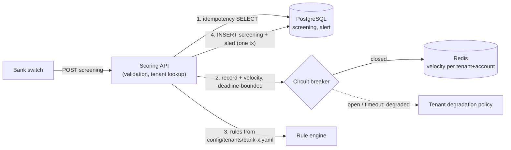

# Project Bulkhead

Real-time scoring path of a hosted fraud-screening service shared by several banks. Each bank's payment
switch calls it synchronously and gets **APPROVE / REVIEW / DECLINE** inside **p95 40 ms / p99 80 ms**,
without waiting on a slow dependency or on another bank's traffic.

## What is built

| Area | What it does | Where |
|---|---|---|
| Scoring API | `POST /v1/tenants/{tenantId}/screenings` returns decision, riskScore 0-100, reasonCodes, evaluationMs, degraded, missingFeatures | `api/`, `screening/` |
| Idempotent ingest | Same tenant + transactionId + payload returns the original decision (also under concurrent retries); different payload returns 409; other tenant = other transaction | `ScreeningService`, `UNIQUE(tenant_id, transaction_id)` |
| Tenant rule packs | One YAML per bank in `config/tenants/`: amount threshold, high-risk country, new beneficiary + high amount, any number of velocity rules, score bands, degradation policy. Unknown tenant 404, broken file 503 for that bank only | `tenant/`, `config/tenants/` |
| Alerts | REVIEW and DECLINE persist an alert in the same transaction as the screening | `ScreeningRepository` |
| Velocity store | In-memory (default) or Redis sorted sets via one Lua script; idempotent by transactionId; keys namespaced by tenant | `features/` |
| Graceful degradation | Per-request deadline, Resilience4j circuit breaker, per-bank policy (FAIL_OPEN / REVIEW_ABOVE_AMOUNT / DECLINE_ABOVE_AMOUNT), `degraded` flag + metric | `ResilientFeatureClient`, `DegradationPolicies` |
| Investigator API | `GET /v1/tenants/{tenantId}/screenings/{transactionId}`: rules fired with thresholds and observed values, masked account token, rule-pack version; tenant-isolated | `ScreeningExplanation` |
| Contract | `docs/api/openapi.yaml`, checked against real responses in `mvn test` | `OpenApiContractTest` |
| Load script | JDK-only runner, tenant mix, 5% duplicates, p50/p95/p99 | `scripts/PerfRunner.java` |

## Architecture overview

**Diagram: Request path for one screening**



1. A retry of an already-scored transaction is answered from PostgreSQL without re-scoring.
2. Velocity features come from Redis inside a timeout computed from the time left; if Redis is slow or down, the rules that need it are skipped and the bank's own policy applies.
3. Rules and thresholds are the bank's own rule pack.
4. The decision and any alert commit together; a concurrent duplicate loses on the unique key and returns the winner's decision.

Architecture pack (10-minute read): [C4 diagrams](docs/architecture/c4.md) · [ADRs](docs/architecture/adr/) · [NFRs and capacity](docs/architecture/nfr.md) · [failure modes](docs/architecture/failure-modes.md) · [perf results](docs/architecture/perf-results.md) · [evolution plan](docs/architecture/evolution-plan.md) · [review checklist](docs/architecture/review-checklist.md) · [OpenAPI](docs/api/openapi.yaml)

## How to run

Requirements: JDK 21, Maven 3.9; Docker only for the PostgreSQL/Redis profile and integration tests.

**Zero-setup (H2 + in-memory velocity store):**
```bash
mvn spring-boot:run
curl -s -X POST localhost:8080/v1/tenants/bank-a/screenings -H "Content-Type: application/json" \
  -d '{"transactionId":"t-1","accountToken":"acct-1234","amount":12000,"currency":"INR","merchantCategory":"5411","beneficiaryId":"ben-1","country":"IN","timestamp":"2026-11-18T06:00:00Z"}'
curl -s localhost:8080/v1/tenants/bank-a/screenings/t-1
```

**PostgreSQL + Redis (docker-compose):**
```bash
cp .env.example .env                      # set POSTGRES_PASSWORD
docker compose up -d
export POSTGRES_PASSWORD=...              # PowerShell: $env:POSTGRES_PASSWORD="..."
mvn spring-boot:run -Dspring-boot.run.profiles=postgres-redis
```

**Onboard a new bank:** add `config/tenants/bank-d.yaml` (copy an existing file, change values) and restart. No code change; `TenantOnboardingTest` proves it.

## How to run the tests

```bash
mvn test                  # all offline tests: no Docker, no PostgreSQL, no Redis, no network
mvn test -Pintegration    # real Redis via Testcontainers (needs Docker): normal -> Redis paused -> recovered
npx @redocly/cli lint docs/api/openapi.yaml   # optional: independent OpenAPI 3 validation
```

**Load test** (service running on :8080):
```bash
java scripts/PerfRunner.java --requests 6000 --concurrency 32 --label "normal"
# degraded mode: start the service with 200 ms injected feature-store latency, then rerun
mvn spring-boot:run -Dspring-boot.run.profiles=postgres-redis -Dspring-boot.run.arguments=--bulkhead.features.fault-delay-ms=200
java scripts/PerfRunner.java --requests 6000 --concurrency 32 --label "degraded: +200 ms feature store"
```

## What I would do next

- Per-tenant bulkheads (semaphore per tenant around feature lookups and DB work) so bank-a's spike cannot starve bank-b; failure mode F9 is the open gap.
- Micrometer timers per hop to check the [per-hop budget](docs/architecture/nfr.md) from metrics, not only end to end.
- Phases in the [evolution plan](docs/architecture/evolution-plan.md): outbox to case management, rule-pack hot reload and rollback, ML score in shadow mode.
- Daily partitions and retention for `screening` (≈118 GB/day at average load).
- Authentication at the gateway (mTLS + per-bank token), declared in the OpenAPI spec.

See [AI_USAGE.md](AI_USAGE.md) for how AI tools were used.
