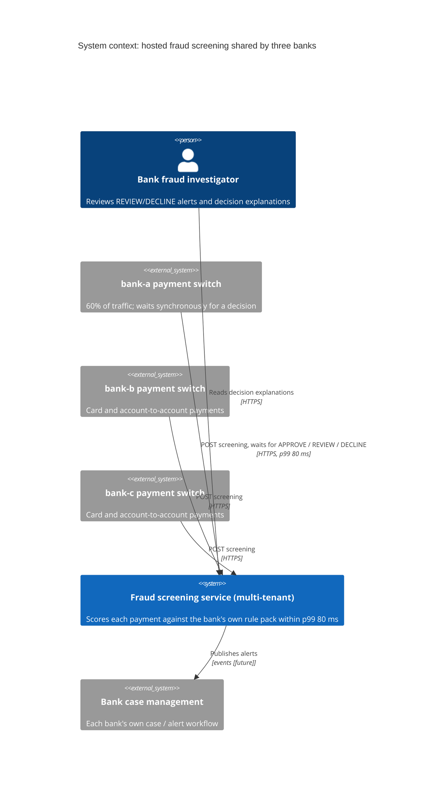
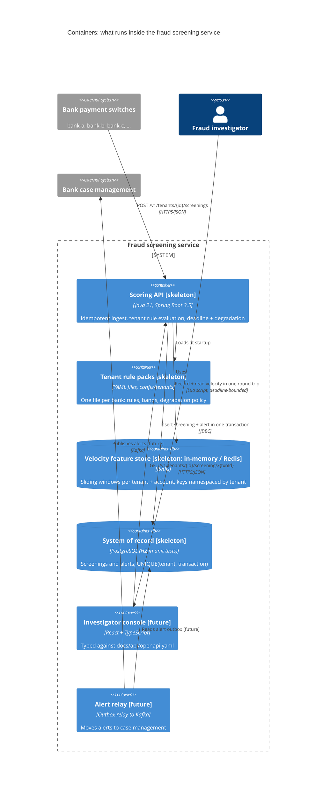

# C4 model: Project Bulkhead

Legend: **[skeleton]** exists and runs in this repo · **[future]** designed, not built yet.

## Level 1: System context

**Diagram 1: Who uses the hosted fraud-screening service**

How to read it:
- The three switches call the service **synchronously** before authorising a payment; the switch's whole fraud check has a hard p99 of 100 ms, of which this service gets p99 80 ms (see [nfr.md](nfr.md)).
- Investigators read explanations; alerts flow to each bank's case management.

## Level 2: Containers

**Diagram 2: Containers inside the fraud screening service**

| Container | Status | Where in the repo |
|---|---|---|
| Scoring API | skeleton | `src/main/java/com/azentio/bulkhead` |
| Tenant rule packs | skeleton | `config/tenants/*.yaml` |
| Velocity feature store | skeleton: in-memory (Task 1), Redis (Task 2) | `features/` |
| System of record | skeleton | `src/main/resources/db/migration` |
| Investigator console | future (contract exists) | `docs/api/openapi.yaml` |
| Alert relay / case management | future | [evolution-plan.md](evolution-plan.md) phase 1 |

Decisions behind this shape: [ADR 0001](adr/0001-synchronous-scoring.md) (synchronous path),
[ADR 0002](adr/0002-idempotency-mechanism.md) (idempotency), [ADR 0003](adr/0003-tenant-config-model.md) (tenant model).
